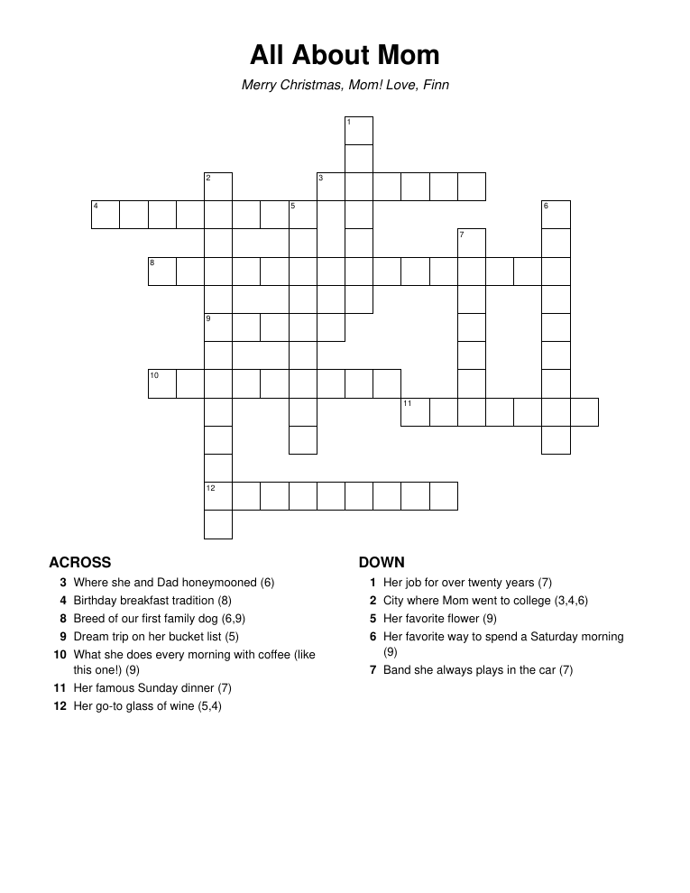

# Custom Crossword Maker

Make personalized, printable crosswords — for example, a puzzle all about a family member's life. You type in your answers and clues; the script figures out how the words cross, numbers the grid, and writes a letter-size PDF with the puzzle and an answer key.



## Setup

```bash
pip install -r requirements.txt
```

(On some Linux setups: `pip install --break-system-packages reportlab`.)

## Usage

1. Open `crossword_maker.py` and edit the config at the top:
   - `TITLE` and `SUBTITLE` (a dedication line)
   - `WORDS`: a list of `(ANSWER, CLUE)` pairs, e.g. `("SAN LUIS OBISPO", "City where Mom went to college")`. Spaces and punctuation are stripped for the grid, and clues show word lengths like `(3,4,6)`.
2. Run:

```bash
python3 crossword_maker.py
```

This writes `crossword.pdf` (puzzle page(s), then the answer key).

### Options

| Flag | What it does |
| --- | --- |
| `--seed 42` | Reproduce the same layout every time |
| `--attempts 3000` | Search harder for a tighter grid |
| `--out mom.pdf` | Choose the output file name |

### Settings (top of the script)

- `SHOW_WORD_LENGTHS` — show `(3,4,6)` after clues
- `SHOW_BLACK_SQUARES` — fill empty cells black (off = only letter boxes drawn)
- `INCLUDE_ANSWER_KEY` — add the answer key page
- `DEFAULT_ATTEMPTS`, `DEFAULT_OUTPUT`

## Tips

- 10–25 words that share common letters fit best.
- If a word can't be placed, the script tells you; rerun or try a different `--seed`.
